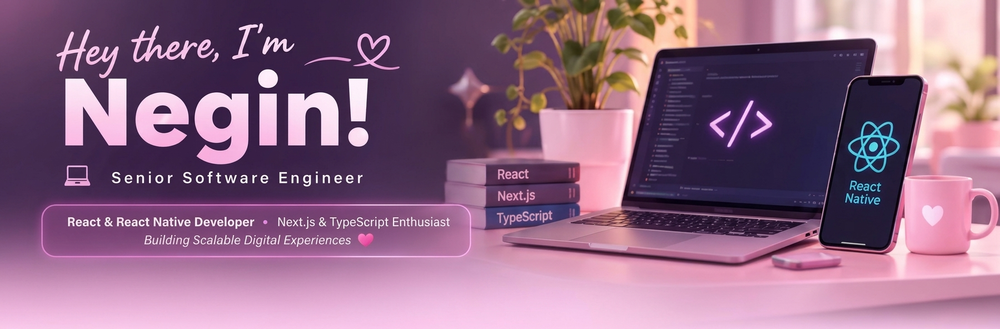

# Hey there, I'm Negin!

  

  

  
  

  

---

## About Me

I'm a **Senior Software Engineer** with 5+ years of experience building modern, scalable, and user-focused web and mobile applications.

I enjoy turning complex requirements into clean, maintainable solutions and creating intuitive experiences across mobile and web platforms.

- Senior Software Engineer
- Focused on React Native and cross-platform mobile development
- Building modern web applications with React and Next.js
- Passionate about clean code and scalable architecture
- Experienced with REST APIs, PostgreSQL, and Drizzle ORM
- Familiar with Docker and modern development workflows
- Always learning, improving, and exploring new technologies

---

## What I Build

<table>
  <tr>
    <td width="50%" valign="top">
      <h3>📱 Mobile Development</h3>
      
Cross-platform applications with React Native, reusable components, and smooth user experiences.

    </td>
    <td width="50%" valign="top">
      <h3>🌐 Web Development</h3>
      
Responsive and scalable web applications using React, Next.js, and TypeScript.

    </td>
  </tr>
  <tr>
    <td width="50%" valign="top">
      <h3>🧩 Frontend Architecture</h3>
      
Maintainable codebases, state management, reusable UI systems, and thoughtful architecture.

    </td>
    <td width="50%" valign="top">
      <h3>⚙️ API & Data Integration</h3>
      
REST API integration, data management, PostgreSQL, and backend-connected applications.

    </td>
  </tr>
</table>

---

## Tech Stack

### Frontend & Mobile

  
  

### State Management & Data

  
  

### Tools & Workflow

  

**Also working with:** Redux Toolkit, Zustand, Axios, REST APIs, Drizzle ORM.

---

## GitHub Analytics

  

<!-- Enable these cards after the Summary Cards workflow successfully publishes the stats branch.

  

  
  

  
  

-->

---

## My Contribution Journey

  <picture>
    <source media="(prefers-color-scheme: dark)" srcset="https://raw.githubusercontent.com/Negin-ozn/Negin-ozn/output/github-contribution-grid-snake-dark.svg">
    <source media="(prefers-color-scheme: light)" srcset="https://raw.githubusercontent.com/Negin-ozn/Negin-ozn/output/github-contribution-grid-snake.svg">
    
  </picture>

---

## Let's Connect

  
  

  <i>Building meaningful experiences, one line of code at a time.</i>

  

