# 🌸 Hey there, I'm Negin!

  

  

  

---

## 💗 About Me

I'm a Senior Software Engineer with 5+ years of experience building scalable, modern, and user-friendly web and mobile applications.

- 👩🏻‍💻 Senior Software Engineer
- 📱 Experienced in React Native & React
- 🌐 Building modern web applications with Next.js
- 🧩 Passionate about clean code and scalable architecture
- 🗄️ Working with PostgreSQL and Drizzle ORM
- 🐳 Using Docker and modern development tools
- 🌱 Always learning and exploring new technologies

---

## 🎀 Tech Stack

  

  

**Frontend & Mobile:** React, React Native, Next.js, TypeScript, JavaScript, Tailwind CSS

**State Management:** Redux Toolkit, Zustand

**Backend & Database:** Drizzle ORM, PostgreSQL, REST APIs, Axios

**DevOps & Testing:** Docker, Git, GitHub, Jest

---

## 🌷 GitHub Analytics

## 🌷 GitHub Analytics

  

  
  

  
  

  

---

## 🐍 My Contribution Journey

  <picture>
    <source media="(prefers-color-scheme: dark)" srcset="https://raw.githubusercontent.com/Negin-ozn/Negin-ozn/output/github-contribution-grid-snake-dark.svg">
    <source media="(prefers-color-scheme: light)" srcset="https://raw.githubusercontent.com/Negin-ozn/Negin-ozn/output/github-contribution-grid-snake.svg">
    
  </picture>

---

## 🌸 Let's Connect

  
  

  <i>✨ Building beautiful things, one line of code at a time. 💗</i>

  

